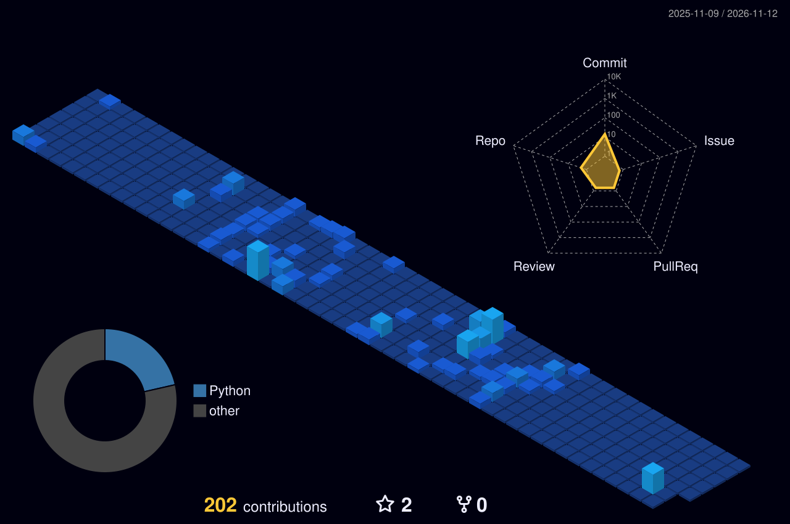

# I'm Daniel

Hobby developer using languages like Python and C# to built applictions using database and APIs

## 🚀 Featured Projects

<table>
<tr>
<td width="33%" align="center">

### 🤖 FAFO-Bot

A Discord bot project.

**Tech & Development**

</td>
<td width="33%" align="center">

### 📍 Cnr-Tracker

A tracking application.

**Tracking & Management**

</td>
<td width="33%" align="center">

### 🗄️ Cnr-Database

A database project.

**Data & Storage**

</td>
</tr>
</table>

<!--

  

-->

### Languages

### Tools

 

 
